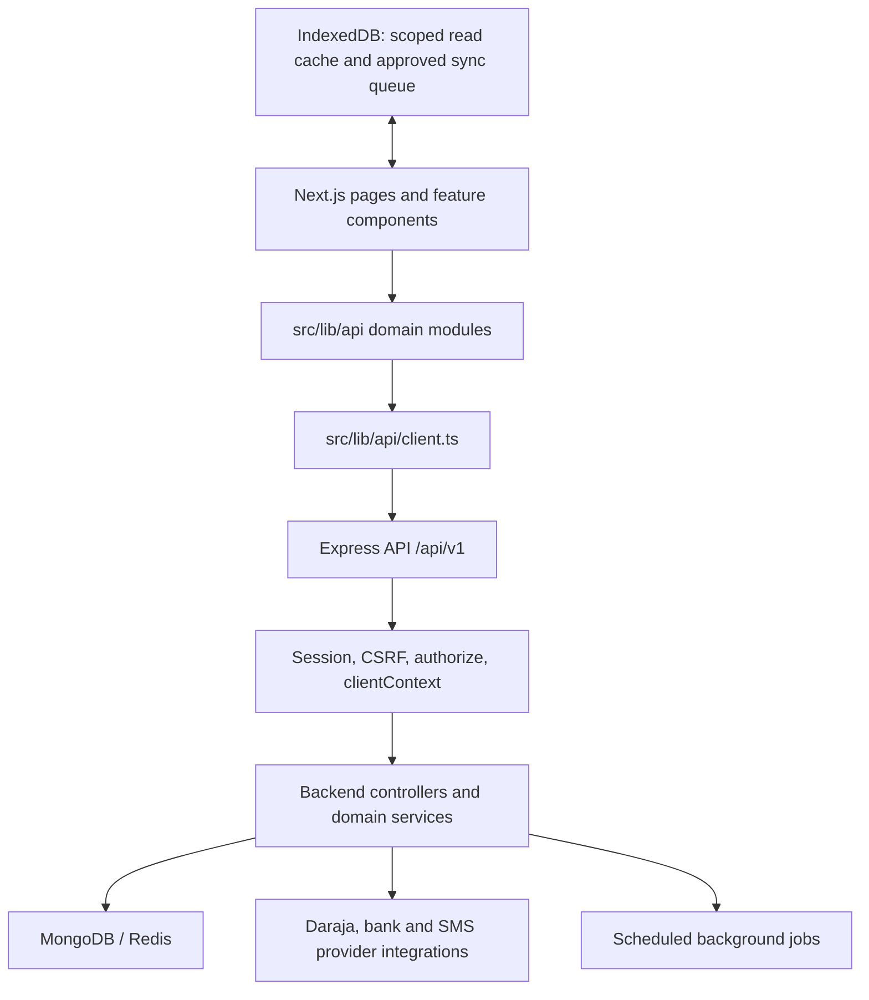

# Tycoon Estates Frontend — Architecture Outline

> Read this file first for a compact project map.  
> Audited: 2026-11-15  
> Frontend code baseline: `jolla3/tycoon-frontend` `main` @ `dc34279bc8f8fcf98ffc9ce5029a7ea38c4f059d`  
> Documentation branch: `docs/frontend-planning-baseline`  
> Backend contract baseline: `jolla3/tycoon-estates-backend` `feat/superadmin-subscription-entitlements` @ `cc98900ba338f5b1e19bdcfe923e4dc45bc87745`  

> **Correction note (2026-11-18):** the backend contract baseline above was a feature branch. The authoritative backend is `main` @ `db7af3d49e827ede7f2cb9a7dbd88574c69224d9`. Where this document and `docs/branch-correction/*` differ (HouseType `estateId` direction, manual-payment tenancy identity, Superadmin response shapes, subscription presence), the branch-correction pack and backend source win. Historical text below is preserved.
> Backend status: platform and entitlement changes are implemented in source; behavioural verification is pending.  
> Detailed product requirements: [`PRD.md`](PRD.md)  
> Endpoint-to-screen map: [`FRONTEND_ENDPOINT_SCREEN_MATRIX.md`](docs/FRONTEND_ENDPOINT_SCREEN_MATRIX.md)

## Agent context — compact outline

- **Product:** multi-tenant property/rent operations workspace for owners, admins, and staff, plus a distinct SUPER_ADMIN control plane for client provisioning, product entitlements, diagnostics and read-only integration monitoring.
- **Not the product:** a full tenant portal. The tenant-facing M-PESA feature is a public one-time-link submission page only.
- **Frontend:** Next.js 14 App Router, React 18, strict TypeScript, MUI 6, TanStack Query 5, IndexedDB via `idb`, Recharts, Lucide React, Motion, and React Three Fiber only for the landing hero.
- **Backend:** Express API under `/api/v1`; it owns authentication, authorization, tenant/client scope, business rules, ledger state, bank/provider credentials, reconciliation, and canonical records.
- **HTTP boundary:** all authenticated feature requests go through `src/lib/api/client.ts`; feature modules live in `src/lib/api/*.ts`. Pages must not call `fetch` directly.
- **Session:** HttpOnly cookie session, `credentials: 'include'`, and centralized CSRF handling for mutations. Do not put session credentials in browser storage.
- **Server state:** TanStack Query. **Offline read cache:** IndexedDB, identity-scoped and visibly stale. **Offline writes:** only explicitly whitelisted safe operations (currently profile update). Financial writes stay online-only.
- **Financial distinctions:** Payment (posted ledger payment with origin/status/tenancy), BankTransaction (bank record), MpesaSmsSubmission (tenant-pasted SMS evidence), and MpesaTransaction (canonical provider receipt) are different records. Unknown ledger balance is null, not zero; house-wide history is not the active tenant liability.
- **Never invent an endpoint:** missing M-PESA receipt listing, merchant-profile management, manual Pull query, password reset, notifications, or generic settings must remain explicit backend dependencies.
- **Current hard defects:** Banking skips BankConnection creation and omits required connectionId; HouseType creation sends estateId but backend validation strips it; HouseType workspace expects obsolete fields; deposit pay/deduct omit mandatory Idempotency-Key headers; tenant/house financial views can convert unknown balances to zero or mix active and historical balances; Payment and BankAccount DTOs omit backend fields; BankTransaction endpoints return raw internal fields; billing-config deactivation uses chargeType instead of configId; Tenants and Transactions omit selected estateId and Transactions filters after pagination. Billing generation is already present in the Estate Workspace Billing tab. Houses already sends estateId; its stale comment/local filter are redundant. Backend middleware remains the security boundary.
- **Planning rule:** keep `PRD.md`, this outline, and the endpoint/screen matrix synchronized before implementation.

## 1. Runtime and stack

| Layer | Current technology | Responsibility |
|---|---|---|
| App framework | Next.js 14.2.15 App Router | Public, client-workspace, and platform route groups |
| UI runtime | React 18.3, TypeScript 5.6 strict | Typed components and application behavior |
| Component/theme system | MUI 6, Emotion | Layout, forms, dialogs, tables, responsive styling |
| Server state | TanStack Query 5 | API queries, mutation lifecycle, invalidation |
| Local persistence | IndexedDB via `idb` | Approved read snapshots and the narrow sync queue |
| Charts | Recharts | Report visualizations |
| Icons | Lucide React | Single icon family |
| Motion | Motion | Limited UI animation |
| Landing visual | React Three Fiber / Three.js | Public landing hero only |

Current package scripts: `dev`, `build`, `start`, `lint`, and `typecheck`. There is no `test` script in the checked package manifest; a test harness is not established in this baseline.

## 2. System boundaries

The frontend is a client of the backend, not a second domain service. It must not implement ledger allocation, M-PESA matching, provider credential management, client scoping, or final payment status itself.

### Source layout

- `src/app/(public)`: landing, login, legal pages, and the future public `/pay` page.
- `src/app/(dashboard)`: authenticated client operational workspace.
- `src/app/(platform)`: SUPER_ADMIN-only platform routes.
- `src/features`: feature-specific state and components.
- `src/lib/api`: typed domain API wrappers and the shared HTTP client.
- `src/lib/permissions`: role-based UX helpers only.
- `src/lib/query`: TanStack Query provider/configuration.
- `src/lib/storage`: IndexedDB schema and cache helpers.
- `src/lib/sync`: connectivity and the explicit offline write allowlist.
- `src/components`: shared layout, feedback, data display, and forms.

## 3. Request and response contract

### Shared API client

`src/lib/api/client.ts` is the only approved HTTP boundary for feature API requests.

- Base URL comes from `NEXT_PUBLIC_API_BASE_URL`. Production must configure it at build time; development can fall back to local API.
- Authenticated requests use `credentials: 'include'`; frontend code does not read or store the HttpOnly session cookie.
- Mutating requests attach the CSRF token through the centralized client logic.
- Response handling expects the backend's standard envelope and returns `payload.data`.
- API failures become typed `ApiError` instances classified by network, auth, forbidden, validation, not-found, server, or unknown status.
- A page or feature module must not introduce its own fetch wrapper, auth header, or CSRF implementation.

### Domain modules

The current wrappers cover auth, profile, estates, houses, house types, tenants, billing, payments, deposits, banking accounts, bank transactions, SMS, reports, staff/users, subscription and an older platform administration module. Its platform DTOs and filters do not yet represent V2 contracts. No frontend wrappers exist yet for entitlement inventory, client diagnostics or platform-wide Banking/M-PESA monitoring.

There is no M-PESA collection wrapper yet. Bank-connection routes are also not represented in the frontend API layer. The barrel at `src/lib/api/index.ts` does not currently re-export all existing domain modules; direct imports are in use. Treat barrel cleanup as code hygiene, not a substitute for implementing missing APIs.

## 4. Authentication, authorization, and scope

- Ordinary dashboard routes use the session context and authenticated route guard.
- Platform routes use the platform guard and require `SUPER_ADMIN`.
- The sidebar and `permissions` helper hide or disable actions for usability only.
- Backend `authorize()` middleware is the actual action-level security boundary.
- Backend client/estate scoping is server-derived by `clientContext`: a requested `estateId` is validated against the authenticated user’s allowed estates and becomes `req.estateFilter`; restricted STAFF without a requested estate receives their assigned `estateIds` as the filter. Never infer that a client-side estate dropdown provides security. Houses sends the selected estate; Tenants and Transactions currently omit it in their list wrappers. Transactions therefore narrows only the current fetched page in the browser.
- The public `/pay` page is intentionally outside the authenticated dashboard shell. Its public submission endpoint uses a separate backend guard.
- Credentialed cross-origin requests require exact-origin CORS with credentials enabled by the backend.

### Public M-PESA token handling

The backend builds a page URL in the form `{FRONTEND_URL}/pay#t={token}`. The token is in the URL fragment, which is not transmitted as part of the HTTP request for the page. The client page must extract it after hydration.

Rules:

1. Do not move the token into a query parameter.
2. Do not persist it in local storage, IndexedDB, a persistent query cache, analytics, telemetry, or logs.
3. Do not show the token again from a cached link record; the issue operation returns it once.
4. Submit only the backend contract `{ token, text }` to `POST /api/v1/public/mpesa/submissions`.
5. The UI response means evidence was accepted for processing, not that rent was posted.
6. Display neutral invalid/revoked/disabled-link feedback; do not disclose token validity details beyond the backend contract.

## 5. State ownership and persistence

| State | Owner | Persistence rule |
|---|---|---|
| Current user/session | Backend session + `SessionProvider` | No session secret in JS storage |
| API data | Backend; cached in TanStack Query | Invalidate/refetch after mutations |
| Approved read snapshots | IndexedDB | Identity-scoped; visible stale/cached marker |
| Offline write queue | IndexedDB sync queue | Explicit operation allowlist only |
| Financial writes | Backend | Online request and confirmed response only |
| UI state | React component state | Transient unless a product requirement explicitly says otherwise |

Current read-cache use is intentionally limited. A cached response must never be presented as live data. User identity changes clear query data, IndexedDB cache, and incompatible sync-queue entries to prevent cross-user exposure.

The current sync queue is deliberately narrow (profile update). Do not add payment creation, deposit operations, bank connection changes, bank sync, transaction assignment, or M-PESA submission resolution to it.

## 6. Frontend view models and financial semantics

Use backend DTOs as the source of truth. The frontend may add presentation-only derived labels, but must not replace backend financial state.

| Model | Meaning | Key rules |
|---|---|---|
| `Estate` | Client-owned property grouping | Client-scoped |
| `HouseType` | Reusable house classification and defaults | Not itself a tenancy or payment |
| `House` | Physical rental unit | Belongs to an estate; may have a current tenant |
| `Tenant` | Renter/customer record | Payer identity is not guaranteed to equal the person who sent money |
| `RentCharge` | Ledger charge for a period/type | Amounts are integer cents; backend owns allocations/status |
| `Payment` | Payment posted to the Tycoon ledger | Use for rent-ledger history |
| `BankConnection` | Provider authorization/credential connection | Separate lifecycle from an individual bank account |
| `BankAccount` | Account registered under a bank connection | Creation requires `connectionId` |
| `BankTransaction` | Imported bank transaction | Reconciliation record; not an M-PESA receipt |
| `MpesaSubmission` | Parsed tenant SMS evidence and review state | Evidence only; cannot independently create a payment |
| `MpesaTransaction` | Canonical provider receipt from Daraja ingestion | No frontend list endpoint in the audited backend baseline |

Money is transported as integer cents. Date/time values must follow the backend's documented timezone/ISO representation. Status values should be modeled from backend DTOs/enums, not made up in the UI.

## 7. Feature integration map

| Feature | Frontend route/screen | Backend API family |
|---|---|---|
| Authentication | `/login` and session context | `/auth/*` |
| Profile | `/profile` | `/profile/*` |
| Portfolio | `/estates`, `/houses`, `/house-types` | `/estates/*`, `/houses/*`, `/house-types/*` |
| Tenants | `/tenants` and tenant workspace | `/tenants/*`, `/deposits/*`, future `/mpesa-collection/*` |
| Billing | Estate Workspace Billing tab generates charges; House Workspace displays account | `/billing/*`, house billing-config routes |
| Payments | `/payments` | `/payments/*` |
| Bank integration | `/banking` | `/bank/connections/*`, `/bank/accounts/*` |
| Bank reconciliation | `/transactions`, `/transactions/unmatched` | `/transactions/*` |
| M-PESA public submission | New single-purpose public `/pay` page for pasted SMS evidence | `/public/mpesa/submissions` |
| M-PESA operator controls/review | New link panel in tenant workspace + submission queue under Payments/Collections | `/mpesa-collection/*` |
| Reporting | `/reports`, dashboard | `/reports/*` |
| Communications | `/sms` | `/sms/*` |
| Staff | `/staff` | `/users/*` |
| Subscription | `/settings` | `/subscription/*` |
| Platform | `/platform/*` | `/platform/*` |

The detailed endpoint map, frontend wrapper, current screen, role notes, and gap status live in `docs/FRONTEND_ENDPOINT_SCREEN_MATRIX.md`.

## 8. Known integration defects and blocked capabilities

### Frontend defects to fix

1. **Banking create flow:** current form calls `POST /bank/accounts` without first creating/selecting a bank connection and without the required `connectionId`. Add connection list/create/detail/reauthorize/disconnect wrappers and UI before account registration.
2. **Billing-config deactivation:** `housesApi.deactivateBillingConfig(houseId, chargeType)` builds a URL using the charge type. Backend route expects `:configId`. Change the input and URL to use the configuration ID.
3. **Estate filtering and cache keys:** backend clientContext validates estateId and enforces assigned estateIds for restricted STAFF. Houses already sends estateId; remove stale comment. Tenants, Transactions and HouseType list omit selected estate. Transactions filters after pagination. Unmatched assignment fetches 200 houses across scope and filters locally. Add server-side estateId query support and include every filter in query/cache keys.
4. **HouseType creation/workspace:** service requires estateId but the route create schema omits it and strips the request; the frontend form/type already send it. Workspace DTO separates current tenancy, historical, unattributed and orphaned financials while page expects obsolete flat fields. Fix backend validation and redesign to actual DTO.
5. **Deposit idempotency:** backend deposit pay/deduct require Idempotency-Key. Wrappers send none and apiClient has no typed header support; these actions currently fail validation. Add stable per-intent key support and reuse on retry.
6. **Financial DTOs:** tenant outstanding can be null and house account distinguishes current-tenancy from house-wide history. Current pages display null as zero or flatten balances. Payment origin/status and BankAccount validation/entitlements are omitted.
7. **Bank transaction response safety:** list/unmatched return raw docs containing processingClaimToken and rawPayload. Backend needs a safe DTO before browser use.
8. **Billing-config deactivation:** wrapper supplies chargeType; route requires configId.
9. **API export surface:** src/lib/api/index.ts omits existing house-type, billing, deposit and subscription modules.

### Backend routes exist but frontend is missing

- M-PESA tenant link inspect/issue/revoke.
- M-PESA tenant SMS evidence submission.
- M-PESA submission list and supported resolve actions.
- Tenant M-PESA account/payment views, if these are needed beyond the existing tenant DTOs.

### Backend route is missing; do not invent it

- Canonical `MpesaTransaction` list/read API.
- Merchant profile management API.
- Manual Daraja Pull query API.
- Forgot/reset password.
- Backend notifications API.
- Generic settings API.

### Backend-only operations

Daraja C2B validation/confirmation, Pull result callbacks, and bank provider webhooks are provider-to-server routes. The browser must not call them. The Pull reconciliation scheduler is a backend job; platform health reports job state but does not expose a manual query operation.

## 9. Routing and role boundaries

- `(public)`: landing, login, privacy, terms, and future `/pay`.
- `(dashboard)`: authenticated client operations.
- `(platform)`: SUPER_ADMIN-only console.
- A Next.js route group in parentheses does not appear in the browser URL. A `page.tsx` beneath `src/app/(public)/pay` resolves to `/pay`.

The existing role helper grants management UX to `CLIENT_OWNER` and `CLIENT_ADMIN`, and platform access to `SUPER_ADMIN`. Staff visibility/actions are constrained in the UI and again by the backend. Never weaken backend enforcement to make a page work.

## 10. Implementation and verification rules

Before feature work:

1. Read `PRD.md`, this file, and the endpoint/screen matrix.
2. Confirm the current backend branch/commit and endpoint contract.
3. Identify whether the task is a frontend defect, an existing backend endpoint not yet surfaced, or a true backend API gap.
4. Update all three planning documents when the contract, workflow, role rules, or scope changes.
5. Only then implement.

For each feature, test: API client contract, response DTO parsing, pending/error/success UI, authorization boundaries, stale/offline behavior, keyboard use, responsive layout, and backend integration.

Do not claim tests passed unless the commands were executed against the current checked-out branch. Do not generate test-result files or persistent logs unless requested.

## 11. Field-level contract corrections

### Request schemas
| Domain | Backend contract | Frontend correction |
|---|---|---|
| BankConnection create | provider, optional displayName, credentialMaterial object | Add separate connection API/form; never persist credentials |
| BankAccount create | estateId, connectionId, provider, accountNumber, accountName, optional currency/allowEstateReassignment | Register account only after usable connection exists |
| HouseType create | Service requires estateId, route create validation currently omits it | Fix backend schema and frontend estate selection/payload |
| HouseType plan update | Service supports effectiveFromPeriod/changeReason; update schema currently strips them | Align validator and versioned-plan editor |
| Tenant PATCH | name/phone/status/moveOutDate only | Remove houseId from update type; use dedicated move |
| House PATCH | estateId is not accepted | Remove estateId from update type |
| Deposit pay/deduct | Mandatory Idempotency-Key header | Add typed header support; stable key per intent and across retries |

### Response models
- Tenant detail: outstandingCents is nullable and includes knownArrearsCents, historicalCoverage, verifiedFullObligation, balanceSource, overdueCents and oldestUnpaidPeriod. Never render null as zero.
- House account: preserve ledger, currentTenancyId, verification metadata, currentTenancyBalanceCents, currentTenancyBalanceVerified, historicalUnattributedCents and balanceSource. Label active-tenancy vs house-wide historical amounts separately.
- HouseType workspace: rebuild around currentTenancy, historicalTenancyFinancials, unattributedLegacyFinancials, orphanedTenancyFinancials and currentOccupancyConflict. Do not read obsolete flat fields.
- BankAccount: include connectionId, validationStatus, lastValidatedAt and entitlements. Connection status and account validation status are distinct.
- BankTransaction: model all backend matchStatus/processingState values, but require safe backend DTO excluding processingClaimToken/rawPayload.
- Payment: include origin, status and tenancyId. Backend list can include REVERSED.
- HouseBillingConfig: include effectiveTo/frequency and deactivate by config _id.
- Deposit GET returns tenant, deposit, activeTenancyId and balance; pay/deduct require Idempotency-Key.
- Billing generation is already in Estate Workspace Billing tab; each estate result also includes eligibleTenancies/partialPeriodExcluded.

## 12. M-PESA frontend architecture (new feature)

M-PESA is not connected in the current frontend. Build a focused vertical slice with one public tenant page and authenticated operator controls. Do not create a tenant portal.

### Route and module boundaries
- Public page: src/app/(public)/pay/page.tsx → /pay. No session guard and no dashboard shell.
- Operator link panel: feature component inside existing tenant workspace.
- Operator evidence queue: new authenticated route under Payments/Collections, for example /payments/mpesa-submissions.
- API modules: src/lib/api/mpesa-collection.ts for authenticated routes and src/lib/api/mpesa-public.ts for public submission.
- Feature components: src/features/mpesa/public-submission, tenant-link and submissions.

### Public page behavior
1. Read token only from URL fragment #t= after client hydration.
2. Keep token in in-memory component state only. Never put it in query cache, IndexedDB, localStorage, telemetry, logs, query parameters or error details.
3. Display one SMS text area and one submit action. No login, balance, checkout, receipt history or account screens.
4. Submit exact body { token, text }; backend owns the public guard and 4 KB body limit.
5. 202 means evidence received for processing only. Use neutral invalid-link/unavailable states; never claim payment posted.
6. Clear sensitive text after accepted submission; never persist it.

### Authenticated link lifecycle
- Inspect returns safe link metadata only; token is never returned.
- Issue/rotate returns { link, token }; token is available once. Build /pay#t=... with configured public app origin matching backend FRONTEND_URL. Keep raw token transient and provide copy/share.
- Revoke invalidates active link and clears local token/display state.
- operational=false means merchant/Till prerequisites are not ready.
- Backend may queue protected onboarding SMS when tenant phone, active merchant profile and FRONTEND_URL exist. Issue response has no delivery result: never say SMS sent/delivered and do not build a duplicate sender.

### Evidence review
- GET submissions defaults to reviewable states and supports state/limit filtering.
- Resolve only supports REJECT and RETRY_MATCH with reason codes DUPLICATE, WRONG_TENANT, NOT_A_RENT_PAYMENT, UNREADABLE, OTHER_DOCUMENTED.
- No approve/force-match. Submission evidence is not a Payment.
- SUPER_ADMIN requests need explicit clientId; regular client operators inherit session scope.

### Missing backend APIs
No canonical MpesaTransaction list/detail, merchant profile CRUD or manual Daraja Pull HTTP endpoint exists. Do not create frontend controls for them. Daraja callbacks and scheduled Pull remain backend-only.

## 13. Financial presentation invariants
- Unknown or unverified is never rendered as KSh 0.
- House-wide historical outstanding is not automatically the current tenant liability.
- Current account, closed-tenancy arrears, tenant credit and pending M-PESA evidence remain distinct.
- BankTransaction, MpesaSmsSubmission, MpesaTransaction and Payment are not interchangeable.
- Money remains integer cents through the API layer; KES formatting is presentation-only.

## 14. Superadmin platform V2 architecture

This section is authoritative for the frontend control-plane design and is based on backend branch feat/superadmin-subscription-entitlements at cc98900ba338f5b1e19bdcfe923e4dc45bc87745. Backend changes are implemented in source; behavioural verification is pending.

### 14.1 Workspace boundary

Keep one Next.js application and the existing (platform) route group. Do not create a second frontend, duplicate session provider or parallel authorization system.

- (dashboard) remains the normal client property-operations workspace.
- (platform) remains the SUPER_ADMIN-only platform control plane.
- Platform-wide pages aggregate cross-client data.
- Client detail/diagnostics pages operate on an explicitly selected client ID while preserving the real SUPER_ADMIN actor. This is not impersonation.
- The dedicated platform diagnostics endpoint can inspect inactive clients; do not weaken clientContext or normal client-route authorization.

Every /api/v1/platform route runs authenticate and authorize('SUPER_ADMIN'). Frontend guards/navigation are usability controls, not the security boundary.

### 14.2 Target route structure

    src/app/(platform)/platform/
    ├── page.tsx                         # Overview
    ├── clients/
    │   ├── page.tsx                     # Client directory + provisioning
    │   └── [clientId]/
    │       ├── page.tsx                 # Client workspace
    │       └── diagnostics/
    │           └── page.tsx             # Optional deep-link diagnostics route
    ├── entitlements/page.tsx            # Product assignment inventory
    ├── integrations/
    │   ├── banking/page.tsx             # Read-only Banking monitor
    │   └── mpesa/page.tsx               # Read-only M-PESA monitor
    ├── users/page.tsx
    ├── subscriptions/page.tsx
    ├── audit/page.tsx
    └── health/page.tsx

Client workspace tabs: Overview, Products & Subscription, Integrations, Diagnostics and Activity. Diagnostics may also have a deep-link route, but should have one implementation.

Target navigation: Overview, Clients, Entitlements, Integrations, Users, Subscriptions, Audit and System Health. Integrations may group Banking and M-PESA beneath one parent.

### 14.3 Feature and API module boundaries

Keep all HTTP traffic through src/lib/api/client.ts. Do not add page-level fetch calls or platform-specific copies of cookie/CSRF logic.

Split the existing platform module by domain as implementation proceeds:

    src/lib/api/platform/
    ├── overview.ts
    ├── clients.ts
    ├── entitlements.ts
    ├── diagnostics.ts
    ├── integrations.ts
    ├── users.ts
    ├── subscriptions.ts
    ├── audit.ts
    └── health.ts

    src/features/platform/
    ├── overview/
    ├── clients/
    ├── entitlements/
    ├── integrations/{banking,mpesa}/
    ├── diagnostics/
    ├── users/
    ├── subscriptions/
    ├── audit/
    └── health/

The existing src/lib/api/platform.ts may temporarily re-export new modules during migration. DTO and query logic must have one owner. Avoid a big-bang framework/state-management rewrite; the current Next.js, React, strict TypeScript, MUI and TanStack Query stack is sufficient.

### 14.4 Platform API contract map

New SUPER_ADMIN-only endpoints:
- PATCH /api/v1/platform/clients/:clientId/subscription — update plan, products and dates for an existing subscription.
- GET /api/v1/platform/entitlement-inventory — paginated client/product assignment inventory.
- GET /api/v1/platform/clients/:clientId/diagnostics — read-only client diagnostics, audit and job evidence.
- GET /api/v1/platform/integrations/banking — read-only BankConnection monitoring and account rollups.
- GET /api/v1/platform/integrations/mpesa — read-only merchant-profile monitoring and ingestion evidence.

Expanded existing endpoints:
- POST /platform/clients accepts products, startDate and endDate.
- GET /platform/clients supports search, product, plan, subscription and integration filters and returns enriched rows.
- GET /platform/clients/:clientId returns expanded subscription, product, portfolio and integration details.
- GET /platform/overview adds productAssignments, bankingIntegration and mpesaIntegration distributions.
- GET /platform/health returns nested application, mongo, redis, scheduler, banking, mpesa and sms objects.
- GET /subscription includes products and assignment actor fields.
- POST /subscription/upgrade remains mounted but always returns 403 FORBIDDEN; customer self-service plan upgrades are retired.

Subscription PATCH accepts plan (trial/basic/pro), products (BANKING/MPESA), startDate and endDate (date or null to clear). Empty/unknown-key bodies are rejected; status is immutable. The route does not create a missing Subscription. Treat this as a backend creation/repair dependency, not a form to retry.

### 14.5 Query-state and invalidation

The client directory query key includes page, limit, search, product, plan, subscriptionStatus, hasSubscription, bankProvider, bankConnectionStatus, bankAccountConnectionStatus, bankValidationStatus, mpesaState, callbackCapability, pullCapability, c2bRegistrationState, pullRegistrationState and isActive.

Query-key families:
- ['platform','overview']
- ['platform','clients',filters]
- ['platform','client',clientId]
- ['platform','diagnostics',clientId]
- ['platform','entitlements',filters]
- ['platform','integrations','banking',filters]
- ['platform','integrations','mpesa',filters]
- ['platform','subscriptions',filters]
- ['platform','audit',filters]
- ['platform','health']

After provisioning/subscription updates, invalidate client detail/list, entitlement inventory, subscription list and overview. After activation changes, invalidate directory/detail, diagnostics and overview. Never present a client-side filter of one paginated page as a complete platform-wide result.

### 14.6 Entitlement and integration semantics

Subscription.products is the sole source for product entitlement. A bank connection or merchant profile is integration evidence, not an entitlement grant. An entitled client may still lack a ready provider integration.

The backend gate checks Client existence, isActive === true and products membership. It does not currently enforce subscription status or start/end dates. Render 403 PRODUCT_NOT_ENTITLED with the backend product/reason and distinguish it from provider configuration/readiness.

- BANKING: /bank/*, /bank/connections/* and /transactions/*.
- MPESA: /mpesa-collection/*.
- Rent billing, manual payments, deposits and standard SMS are not gated by these product checks.

Remove client self-service subscription upgrades. The Platform Manager owns plan/product/date changes.

### 14.7 Monitoring and health safety

Platform Banking monitoring is one row per BankConnection with BankAccount rollups. Platform M-PESA monitoring is one row per merchant profile and keeps callback capability independent from Pull capability. Both screens are read-only.

Never model credential references, ciphertext, account secrets, OAuth tokens or raw provider payloads in browser DTOs. Do not add reauthorization/disconnect/merchant CRUD/manual Pull controls to these Superadmin views.

Health generation makes no live provider calls. Configured, implemented, provider-verified and operational are distinct states. Co-op implementation/configuration is not live verification; KCB/Equity/NCBA remain unimplemented; Daraja app credential presence is not per-Till authorization; SMS provider acceptance does not prove handset delivery.

The current health page expects flat string fields and calls string methods such as toLowerCase. The new health response is nested objects. Rebuild DTO and page before consuming it.

### 14.8 Rollout and missing capabilities

- Existing/default subscriptions may have products: []. Clients have no Banking/M-PESA entitlement until Manager assignment; rollout requires an explicit assignment plan.
- A client with no subscription appears in inventory but cannot be repaired using the subscription PATCH route.
- No automatic entitlement expiry based on status/dates exists.
- Canonical MpesaTransaction list/detail, merchant-profile CRUD and manual Daraja Pull HTTP endpoints remain absent.
- Platform integration pages are monitoring-only; provider callbacks and scheduled jobs remain backend-only.
- Backend platform changes are implemented in source at the recorded branch/commit, but behavioural verification is pending.

### 14.9 Verification boundary

This branch changes planning documents only. No frontend runtime, build, lint or browser acceptance evidence is claimed.

## Financial-correctness audit addendum

Unknown, null and unverified financial values render as "Not available"; verified zeros render as zeros; no aggregate stands in for another. Dashboard, reports, payments, estate/house/tenant workspaces follow this rule (see docs/FRONTEND_ENDPOINT_SCREEN_MATRIX.md section 18). Status: IMPLEMENTED. Unresolved BLOCKED BY BACKEND item: `GET /transactions` and `GET /transactions/unmatched` return raw BankTransaction documents including `processingClaimToken` and `rawPayload` (verified: no projection in `transaction.service.js`); a safe DTO is required before bank transaction browsing can be called secure.

## Implementation status

The frontend now implements the M-PESA public `/pay` page, operator link panel and review queue, the bank connection lifecycle, estate-scoped server-side filtering and the Platform V2 screens. The authoritative per-item status (IMPLEMENTED / BLOCKED BY BACKEND / NOT IMPLEMENTED), files and blockers are in section 19 of `docs/FRONTEND_ENDPOINT_SCREEN_MATRIX.md`. Nothing was exercised against a live backend.
