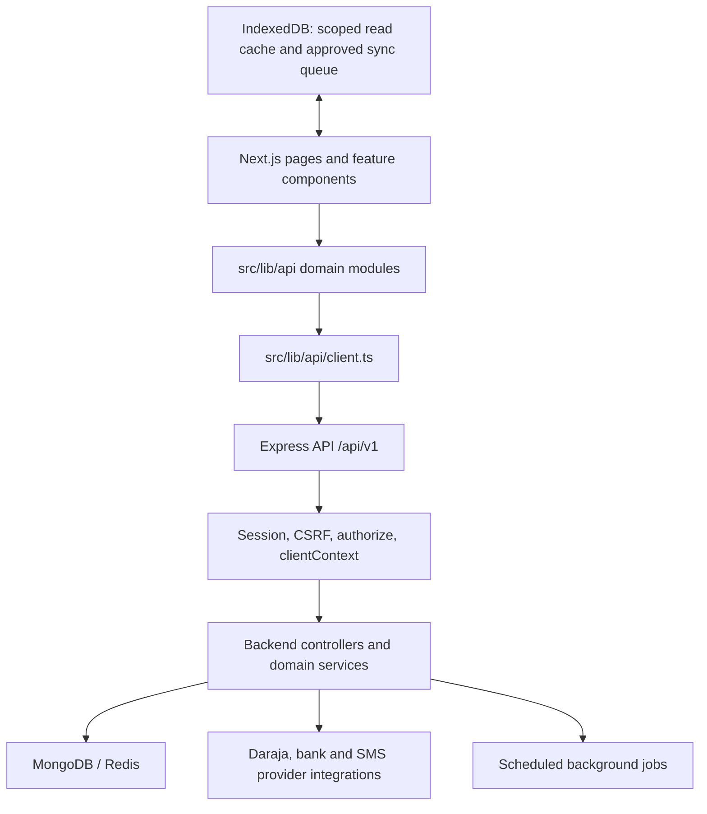

# Tycoon Estates Frontend — Architecture Outline

## Authoritative M-PESA architecture correction — 2026-11-19

This target architecture supersedes the earlier one-estate-per-Till design notes below. The current review-branch implementation is still narrower and must be treated as a migration starting point, not as the final domain model.

### Target ownership model

```text
Client
  ├── Estate A
  ├── Estate B
  ├── Estate C
  └── MpesaMerchantProfile (one actual provider shortcode)
        ├── merchant type: PAYBILL | BUY_GOODS_TILL
        ├── shared platform callback registration evidence
        ├── protected Pull nominated-number reference (when enabled)
        ├── Estate mapping A
        ├── Estate mapping B
        └── Estate mapping C

MpesaCollectionReference
  └── merchantProfile + estate + tenant -> stable BillRefNumber
```

- `MpesaMerchantProfile` is the client-owned merchant identity. It must not carry one authoritative estateId for a merchant serving multiple estates.
- Add an explicit `MpesaMerchantProfileEstate` mapping relation with clientId, merchantProfileId, estateId, lifecycle state and actor/audit metadata. A profile may map to many same-client estates; an estate may use more than one profile when it has multiple legitimate collection channels.
- Add an explicit PayBill collection-reference relation (for example `MpesaCollectionReference`) that maps a normalized reference to exactly one merchant profile, client, estate and tenant. Enforce uniqueness per merchant profile + normalized reference. Do not reuse retired references for another tenant.
- A tenant moving estate receives a new estate-scoped collection reference; the historical reference remains resolvable to the old estate so late payments are not reassigned.
- Merchant identity must be unique across Clients within the configured provider environment. The existing unique index `(clientId,businessShortCode)` is insufficient because callback resolution searches by shortcode across clients. Align the unique index and lookup scope; fail closed on duplicate/ambiguous ownership. If one database ever hosts multiple Daraja environments, include the environment in the identity key rather than allowing sandbox/live collisions.

### Receipt lifecycle and allocation

1. C2B confirmation or Pull ingestion resolves the merchant by provider + shortcode in the configured environment and persists a canonical merchant-scoped receipt. It must not infer an estate from the merchant's list of mappings.
2. For PayBill, resolve BillRefNumber through the active collection-reference mapping. A missing, unknown, retired or ambiguous reference remains unallocated/manual review. Safaricom's reference field is optional, so provider receipt validity does not imply Tycoon allocation readiness.
3. For Buy Goods Till, retain the existing tenant-specific SMS evidence/link path. Match the canonical receipt to the submitted tenant/estate and confirm the merchant-estate mapping before G5 posting.
4. Resolve tenant and estate independently from payer identity. Payer != tenant. Do not compare payer MSISDN/name to the tenant or treat it as ownership evidence.
5. Only the existing G5 verified receipt + evidence + conditional claim/fencing + G3 settlement path may create Payment/Ledger effects. BillRefNumber is routing evidence, not a bypass of existing posting gates.
6. Set `attributedEstateId` only when an exact, verified allocation is made. Unallocated receipts retain merchant/client identity and null estate attribution.

### Callback and registration configuration

- Tycoon owns the Daraja application credentials, runtime environment and callback endpoint host. Clients do not enter Consumer Key/Secret or host callback URLs.
- A platform-level, environment-scoped callback configuration supplies shared C2B confirmation, optional validation and Pull-results URLs. Those same endpoint URLs are registered against each merchant shortcode. The merchant profile records the configuration reference/version and URL snapshot used for its registration.
- Keep per-merchant registration evidence separate: C2B registration state, response type, attempt/success timestamps and safe provider identifiers; Pull registration state, callback configuration version and timestamps.
- Pull nominated MSISDN is merchant-specific KYC data. Store encrypted/protected (or by a dedicated secret reference), expose masked only, and never accept it from a browser response or write it to logs.
- External C2B validation is optional and requires Safaricom activation for the shortcode. The current handler that always returns Accepted is not production-safe. Validation must resolve the merchant and configured BillRefNumber, enforce the product's reference rules, and return a correct provider response within the documented time limit.
- Callback authenticity/abuse control remains unresolved in the current provider evidence. A shortcode in an unauthenticated request is not authentication. Keep callback exposure and automatic posting blocked until the trust boundary is established and tested.
- Registration state != capability state != operational state. A successful register call does not by itself verify callbacks or Pull ingestion. Treat network timeouts as UNCERTAIN and reconcile before retrying.

### Estate visibility and history

- Never implement estate filtering by returning every receipt for every merchant profile mapped to that estate. With a shared PayBill, that would expose receipts belonging to all estates that use the shortcode.
- Estate-restricted users may see only receipts with an exact collection-reference resolution to their estate or a completed verified `attributedEstateId` matching their scope.
- Unallocated receipts are visible only in an explicitly authorized client-wide review scope. Owner/admin client scope and platform Superadmin scope remain distinct.
- Keep the existing Transactions page. Show merchant type, shortcode, BillRefNumber and allocation/verification/posting state in the canonical receipt source; do not merge `MpesaTransaction`, `MpesaSmsSubmission` and G3 Payment into one record type.

### Migration and implementation order

1. Inventory merchant profiles, shortcode duplicates across clients, legacy estateId values, receipt profile links, SMS links and posting attribution. Do not rewrite historical attributedEstateId.
2. Design the new merchant-estate mapping and PayBill reference indexes with explicit migration gates and rollback. Backfill each existing profile.estateId into one mapping before removing the legacy field.
3. Establish the provider/environment merchant identity index and align callback lookup. Detect conflicts before applying the unique index; do not auto-merge clients.
4. Add PayBill normalization and transaction-type acceptance without weakening Buy Goods checks. Add collection-reference allocation and preserve unmatched receipts.
5. Update G5 submission-link/merchant resolution and posting checks to use active mappings instead of profile.estateId equality.
6. Update client/estate receipt query scopes so shared-shortcode receipts cannot leak between estates.
7. Add Superadmin profile editing and multi-estate mapping, safe registration evidence display, and protected Pull-number capture. Keep provider registration as a separate explicit action.
8. Test migrations, duplicate shortcodes, cross-client isolation, BillRef uniqueness, missing/ambiguous references, late receipts after tenant moves, shared merchant across three estates, posting races and history visibility before any live provider enablement.

### Current source findings that constrain the work

- Current `MpesaMerchantProfile` permits only `BUY_GOODS_TILL` and has one optional `estateId`.
- Current callback lookup searches profiles by provider + shortcode across all clients, while the unique index is only `(clientId,businessShortCode)`; these are inconsistent identity boundaries.
- Current normalizer recognizes PayBill but quarantines it as unsupported; current G5 evidence check allows Buy Goods only and requires `profile.estateId === link.estateId`.
- Current C2B validation handler returns Accepted without reference/business validation.
- Current Pull registration function takes `shortCode`, `nominatedNumber` and `callBackUrl`, but the merchant profile does not store the nominated number or a versioned callback snapshot.
- Current M-PESA transaction listing can use profile-to-estate association. That strategy is unsafe for shared merchants and must be replaced with receipt-level exact allocation for estate-restricted views.


## Review implementation update — 2026-11-19 (not merged to main)

Implementation branches: frontend and backend `docs/superadmin-onboarding-and-history`. Use the current PR heads for review; main remains unchanged after the earlier P0 merges.

### Contracts now wired on the review branches

- New Tenant selection: modal-level estate state, `GET /houses` with `status=vacant` and pagination. Backend vacancy filtering requires active house, no tenantId and no ACTIVE Tenancy. `tenancyService.open` rechecks the same conditions inside the transaction.
- Superadmin Banking: extracted `BankingSetupPanel`, selected clientId is query-scoped on `/bank/connections` and `/bank/accounts` calls; write route allowlists add SUPER_ADMIN after `clientContext` and `requireProduct('BANKING')`. Existing service and encrypted secret boundary are reused.
- Superadmin M-PESA: `POST /platform/clients/:clientId/mpesa-profiles` with `{businessShortCode, displayName?, estateId}`; client and estate are revalidated inside transaction, `merchantRegistration` index readiness is mandatory, state is DRAFT/UNKNOWN/NONE, and auditRequired shares the transaction.
- Canonical receipt history: `GET /mpesa-transactions` (authenticate, clientContext, requireProduct MPESA, strict filters, pagination, canonical query-index readiness). DTO exposes receipt/business reference/date/amount/source/verification/claim/posting state only. Frontend displays this source inside existing Transactions page.

### Important boundary decisions

- Existing BankConnection credentials are Tycoon customer Co-op OAuth material stored via BankCredential; Superadmin is the audit actor and explicit clientId chooses the target. No new secret store exists.
- Tycoon Daraja Consumer Key/Secret remain platform process configuration; a client's M-PESA profile stores the merchant Till/shortcode identity only.
- Current code still supports only `BUY_GOODS_TILL` + one estateId and starts profiles in DRAFT. This is an implementation gap against the authoritative shared-merchant target above: PayBill, many-to-many estate mappings and registration snapshots are not implemented yet.
- BankTransaction, MpesaTransaction, MpesaSmsSubmission and G3 Payment remain distinct records. The Transactions page displays BankTransaction or canonical MpesaTransaction by client entitlement. It never treats SMS evidence as receipt history or a posted payment.
- Backend endpoint readiness gates fail closed if the unique merchant index or canonical receipt query indexes are missing.

### Review-only status

Implementation has not been merged or deployed. New backend tests are committed but not run. Browser acceptance, replica-set integration tests and live provider tests remain required. The manual-options candidate cap is fixed in code (see Manual-payment tenancy selection below); DB-backed verification is still pending.

## Design review hardening — 2026-11-19

Before implementation, the plan was challenged for hidden assumptions and unsafe shortcuts:

1. **The first implementation slice was too narrow.** The source has one optional estateId and G5 enforces equality with the tenant link, but the product target is one merchant profile to many same-client estates through an explicit mapping. Remove the one-estate assumption with a staged migration; do not duplicate shortcode profiles.
2. **Create-profile is not provider registration.** C2B and Pull use Tycoon-hosted shared callback endpoints registered against each shortcode. Store callback configuration version/URL snapshots on the merchant profile. Pull also needs the shortcode's nominated MSISDN in protected storage. Keep profile create separate from explicit registration and operational verification.
3. **Merchant identity is global to the provider shortcode.** Current callback lookup searches shortcode across clients, but the unique index is only per client. Inventory collisions and migrate to one owner per provider/environment shortcode with a migration-controlled unique index.
4. **Transaction history must not combine record types.** M-PESA history reads canonical MpesaTransaction receipts, not SMS submissions and not ledger Payment rows. The DTO must be safe and scope by client plus the selected estate's merchant profiles/attribution.
5. **Banking access stays entitlement-gated.** Superadmin must use one explicit active clientId through clientContext. The existing BANKING entitlement check remains active. Do not add a global/bypass route or store new credentials. Existing Co-op credentials remain encrypted in BankCredential.
6. **Tenant availability must be authoritative.** Filter active houses and exclude active tenancies, but also recheck inside the same Mongo transaction that opens the tenancy. A dropdown is not a concurrency or authorization boundary.
7. **No broad UI redesign.** Fix the platform content shrink/wrap and breakpoint issues at the shell/evidence components. Do not replace the whole Superadmin UI or introduce a new design system.

## Current implementation and target-boundary amendment — 2026-11-19 (authoritative)

Current main commits: frontend e525b046b73254c6a49dc163319efa3a087169a3; backend 25d9969eb4f1c734f360337f0a3d64b83d465a6a. This section supersedes older source-status claims below while preserving project history.

### Selected-client bank onboarding

Reuse existing /bank/connections and /bank/accounts routes and their current connectionService, bankService and encrypted BankCredential model. For Superadmin operations, every request must provide one explicit clientId accepted by clientContext. That middleware verifies the target client is active and resolves req.clientId. The existing requireProduct(BANKING) remains mandatory. Add SUPER_ADMIN to mutation route allowlists only after clientContext; do not create a wildcard client scope or impersonate CLIENT_OWNER. Frontend wrappers must carry the selected clientId on list, create, reauthorize, disconnect, account registration and sync calls. Keep the actual Superadmin as the audit actor.

### M-PESA profile management

The target M-PESA profile is a client-owned shortcode identity with merchantType PAYBILL or BUY_GOODS_TILL. Replace the single estateId with an explicit many-to-many merchant-estate mapping and add a unique PayBill collection-reference mapping to tenant + estate. Tycoon owns the Daraja app credentials and shared callback URLs. Each profile records the platform callback-config version/URL snapshot used for registration; Pull nominated MSISDN is merchant-specific and must be protected/encrypted + masked. Do not ask clients to host callbacks or enter platform app credentials. Keep creation DRAFT and registration/capability/operational states separate. See the authoritative correction near the top of this file.

A platform OAuth token proves app authentication only, not authorization for each client Till. Profile readiness and posting remain gated by merchant-specific evidence.

### Shared transaction-history read model

Keep the current Transactions navigation and page. Banking uses existing GET /transactions and safe BankTransaction DTOs. Add a paginated M-PESA provider-receipt read route using authenticated clientContext, requireProduct(MPESA), clientId and the enforced estate filter. Its DTO must be allowlisted and distinguish verification, claim and posting states. Estate scope must be resolved through the mapped merchant profile or attributed estate without widening across clients. Do not return lease tokens, encrypted material or raw provider payloads. MpesaSmsSubmission and G3 Payment remain separate record types.

### Tenant availability and responsive layout

The New Tenant modal owns estate selection and renders explicit loading/error/empty states. Its availability query is client/estate scoped, active-house scoped and excludes active tenancies; create revalidates availability atomically. In the Superadmin shell, main content must shrink with minWidth: 0. Evidence values must wrap, and System Health cards must use one column while the remaining content width is constrained.

### Verification boundaries

The two P0 branches are merged into main. Reported unit test success is not a substitute for the 19 unexecuted database integration tests, browser acceptance or live-provider verification. The manual-options cap is fixed in code (unit and faked-API browser checks); DB-backed verification is still pending.

> Read this file first for a compact project map.  
> Audited: 2026-11-15  
> Frontend code baseline: `jolla3/tycoon-frontend` `main` @ `e525b046b73254c6a49dc163319efa3a087169a3`  
> Documentation branch: `docs/frontend-planning-baseline`  
> Backend contract baseline: `jolla3/tycoon-estates-backend` `feat/superadmin-subscription-entitlements` @ `cc98900ba338f5b1e19bdcfe923e4dc45bc87745`  


> **Correction note (2026-11-18):** the backend contract baseline above was a feature branch. The authoritative backend is `main` @ `25d9969eb4f1c734f360337f0a3d64b83d465a6a`. Where this document and `docs/branch-correction/*` differ (HouseType `estateId` direction, manual-payment tenancy identity, Superadmin response shapes, subscription presence), the branch-correction pack and backend source win. Historical text below is preserved.
> Backend status: platform and entitlement changes are implemented in source; behavioural verification is pending.  
> Detailed product requirements: [`PRD.md`](PRD.md)  
> Endpoint-to-screen map: [`FRONTEND_ENDPOINT_SCREEN_MATRIX.md`](docs/FRONTEND_ENDPOINT_SCREEN_MATRIX.md)

## Agent context — compact outline

- **Product:** multi-tenant property/rent operations workspace for owners, admins, and staff, plus a distinct SUPER_ADMIN control plane for client provisioning, product entitlements, diagnostics and read-only integration monitoring.
- **Not the product:** a full tenant portal. The public one-time-link `/pay` page remains narrow; merchant routing, PayBill references and receipt allocation are backend-owned.
- **Frontend:** Next.js 14 App Router, React 18, strict TypeScript, MUI 6, TanStack Query 5, IndexedDB via `idb`, Recharts, Lucide React, Motion, and React Three Fiber only for the landing hero.
- **Backend:** Express API under `/api/v1`; it owns authentication, authorization, tenant/client scope, business rules, ledger state, bank/provider credentials, reconciliation, and canonical records.
- **HTTP boundary:** all authenticated feature requests go through `src/lib/api/client.ts`; feature modules live in `src/lib/api/*.ts`. Pages must not call `fetch` directly.
- **Session:** HttpOnly cookie session, `credentials: 'include'`, and centralized CSRF handling for mutations. Do not put session credentials in browser storage.
- **Server state:** TanStack Query. **Offline read cache:** IndexedDB, identity-scoped and visibly stale. **Offline writes:** only explicitly whitelisted safe operations (currently profile update). Financial writes stay online-only.
- **M-PESA target:** one client-owned PAYBILL/TILL merchant profile can map to many same-client estates. PayBill BillRefNumber resolves through a unique tenant+estate collection reference; Till continues through tenant SMS evidence. Tycoon owns shared callback endpoints and records their config version on each profile; Pull nominated MSISDN is protected merchant data. Estate history filters by exact receipt allocation, not shared-profile membership.
- **Financial distinctions:** Payment (posted ledger payment), BankTransaction, MpesaSmsSubmission and MpesaTransaction remain separate records. One M-PESA merchant can serve multiple estates; PayBill BillRefNumber maps to a tenant/estate collection reference, while Till continues through tenant evidence. Estate history must filter by resolved receipt attribution/reference, never by shared profile membership alone.
- **Endpoints now implemented on the paired backend review branch (verified in source):** multi-estate PAYBILL/TILL profile create, estate map/unmap, protected Pull number, explicit C2B/Pull registration + reconcile, reference issue/list/retire, shared callback config, allocation-aware receipt list, paginated manual-options. A manual Pull query action still has no contract. **Never invent an endpoint:** other missing contracts (e.g. a tenant-facing reference delivery flow) still need explicit backend contracts before UI controls are built.
- **Current hard defects:** Banking skips BankConnection creation and omits required connectionId; HouseType creation sends estateId but backend validation strips it; HouseType workspace expects obsolete fields; deposit pay/deduct omit mandatory Idempotency-Key headers; tenant/house financial views can convert unknown balances to zero or mix active and historical balances; Payment and BankAccount DTOs omit backend fields; BankTransaction endpoints return raw internal fields; billing-config deactivation uses chargeType instead of configId; Tenants and Transactions omit selected estateId and Transactions filters after pagination. Billing generation is already present in the Estate Workspace Billing tab. Houses already sends estateId; its stale comment/local filter are redundant. Backend middleware remains the security boundary.
- **Planning rule:** keep `PRD.md`, this outline, and the endpoint/screen matrix synchronized before implementation.

## 1. Runtime and stack

| Layer | Current technology | Responsibility |
|---|---|---|
| App framework | Next.js 14.2.15 App Router | Public, client-workspace, and platform route groups |
| UI runtime | React 18.3, TypeScript 5.6 strict | Typed components and application behavior |
| Component/theme system | MUI 6, Emotion | Layout, forms, dialogs, tables, responsive styling |
| Server state | TanStack Query 5 | API queries, mutation lifecycle, invalidation |
| Local persistence | IndexedDB via `idb` | Approved read snapshots and the narrow sync queue |
| Charts | Recharts | Report visualizations |
| Icons | Lucide React | Single icon family |
| Motion | Motion | Limited UI animation |
| Landing visual | React Three Fiber / Three.js | Public landing hero only |

Current package scripts: `dev`, `build`, `start`, `lint`, `typecheck` and `test` (vitest, pure-logic tests under `src/**/*.test.ts`; there is no component/browser test harness).

## 2. System boundaries



The frontend is a client of the backend, not a second domain service. It must not implement ledger allocation, M-PESA matching, provider credential management, client scoping, or final payment status itself.

### Source layout

- `src/app/(public)`: landing, login, legal pages, and the future public `/pay` page.
- `src/app/(dashboard)`: authenticated client operational workspace.
- `src/app/(platform)`: SUPER_ADMIN-only platform routes.
- `src/features`: feature-specific state and components.
- `src/lib/api`: typed domain API wrappers and the shared HTTP client.
- `src/lib/permissions`: role-based UX helpers only.
- `src/lib/query`: TanStack Query provider/configuration.
- `src/lib/storage`: IndexedDB schema and cache helpers.
- `src/lib/sync`: connectivity and the explicit offline write allowlist.
- `src/components`: shared layout, feedback, data display, and forms.

## 3. Request and response contract

### Shared API client

`src/lib/api/client.ts` is the only approved HTTP boundary for feature API requests.

- Base URL comes from `NEXT_PUBLIC_API_BASE_URL`. Production must configure it at build time; development can fall back to local API.
- Authenticated requests use `credentials: 'include'`; frontend code does not read or store the HttpOnly session cookie.
- Mutating requests attach the CSRF token through the centralized client logic.
- Response handling expects the backend's standard envelope and returns `payload.data`.
- API failures become typed `ApiError` instances classified by network, auth, forbidden, validation, not-found, server, or unknown status.
- A page or feature module must not introduce its own fetch wrapper, auth header, or CSRF implementation.

### Domain modules

The current wrappers cover auth, profile, estates, houses, house types, tenants, billing, payments, deposits, banking accounts, bank transactions, SMS, reports, staff/users, subscription and an older platform administration module. Its platform DTOs and filters do not yet represent V2 contracts. No frontend wrappers exist yet for entitlement inventory, client diagnostics or platform-wide Banking/M-PESA monitoring.

There is no M-PESA collection wrapper yet. Bank-connection routes are also not represented in the frontend API layer. The barrel at `src/lib/api/index.ts` does not currently re-export all existing domain modules; direct imports are in use. Treat barrel cleanup as code hygiene, not a substitute for implementing missing APIs.

## 4. Authentication, authorization, and scope

- Ordinary dashboard routes use the session context and authenticated route guard.
- Platform routes use the platform guard and require `SUPER_ADMIN`.
- The sidebar and `permissions` helper hide or disable actions for usability only.
- Backend `authorize()` middleware is the actual action-level security boundary.
- Backend client/estate scoping is server-derived by `clientContext`: a requested `estateId` is validated against the authenticated user’s allowed estates and becomes `req.estateFilter`; restricted STAFF without a requested estate receives their assigned `estateIds` as the filter. Never infer that a client-side estate dropdown provides security. Houses sends the selected estate; Tenants and Transactions currently omit it in their list wrappers. Transactions therefore narrows only the current fetched page in the browser.
- The public `/pay` page is intentionally outside the authenticated dashboard shell. Its public submission endpoint uses a separate backend guard.
- Credentialed cross-origin requests require exact-origin CORS with credentials enabled by the backend.

### Public M-PESA token handling

The backend builds a page URL in the form `{FRONTEND_URL}/pay#t={token}`. The token is in the URL fragment, which is not transmitted as part of the HTTP request for the page. The client page must extract it after hydration.

Rules:

1. Do not move the token into a query parameter.
2. Do not persist it in local storage, IndexedDB, a persistent query cache, analytics, telemetry, or logs.
3. Do not show the token again from a cached link record; the issue operation returns it once.
4. Submit only the backend contract `{ token, text }` to `POST /api/v1/public/mpesa/submissions`.
5. The UI response means evidence was accepted for processing, not that rent was posted.
6. Display neutral invalid/revoked/disabled-link feedback; do not disclose token validity details beyond the backend contract.

## 5. State ownership and persistence

| State | Owner | Persistence rule |
|---|---|---|
| Current user/session | Backend session + `SessionProvider` | No session secret in JS storage |
| API data | Backend; cached in TanStack Query | Invalidate/refetch after mutations |
| Approved read snapshots | IndexedDB | Identity-scoped; visible stale/cached marker |
| Offline write queue | IndexedDB sync queue | Explicit operation allowlist only |
| Financial writes | Backend | Online request and confirmed response only |
| UI state | React component state | Transient unless a product requirement explicitly says otherwise |

Current read-cache use is intentionally limited. A cached response must never be presented as live data. User identity changes clear query data, IndexedDB cache, and incompatible sync-queue entries to prevent cross-user exposure.

The current sync queue is deliberately narrow (profile update). Do not add payment creation, deposit operations, bank connection changes, bank sync, transaction assignment, or M-PESA submission resolution to it.

## 6. Frontend view models and financial semantics

Use backend DTOs as the source of truth. The frontend may add presentation-only derived labels, but must not replace backend financial state.

| Model | Meaning | Key rules |
|---|---|---|
| `Estate` | Client-owned property grouping | Client-scoped |
| `HouseType` | Reusable house classification and defaults | Not itself a tenancy or payment |
| `House` | Physical rental unit | Belongs to an estate; may have a current tenant |
| `Tenant` | Renter/customer record | Payer identity is not guaranteed to equal the person who sent money |
| `RentCharge` | Ledger charge for a period/type | Amounts are integer cents; backend owns allocations/status |
| `Payment` | Payment posted to the Tycoon ledger | Use for rent-ledger history |
| `BankConnection` | Provider authorization/credential connection | Separate lifecycle from an individual bank account |
| `BankAccount` | Account registered under a bank connection | C¢ëiºÛkºwµç_ºYhºÚn¶Æ¯yÛhşiíıø¥zÏÜ¢jh²*?¢ëiºßÛjÈij»lµÚ.¶ÜmFéÜjßæ�ßߊW¬ıÊ&¦‹"£ú.¶›­ı¶¬†–«¶Ë]¢ëmÆÛh¾'°¶ŸºYhºÚn¶Šî±è^iÙõÓOæ�ßߊW¬ıÊ&¦‹"£ú.¶›­ı¶¬†–«¶Ë]¢ëmÆßíj)g×M?š{~)^³÷(šš,Š�èºÚn·öÚ²Z®Û-v‹­·m¢ø�–«¶ÊŠ