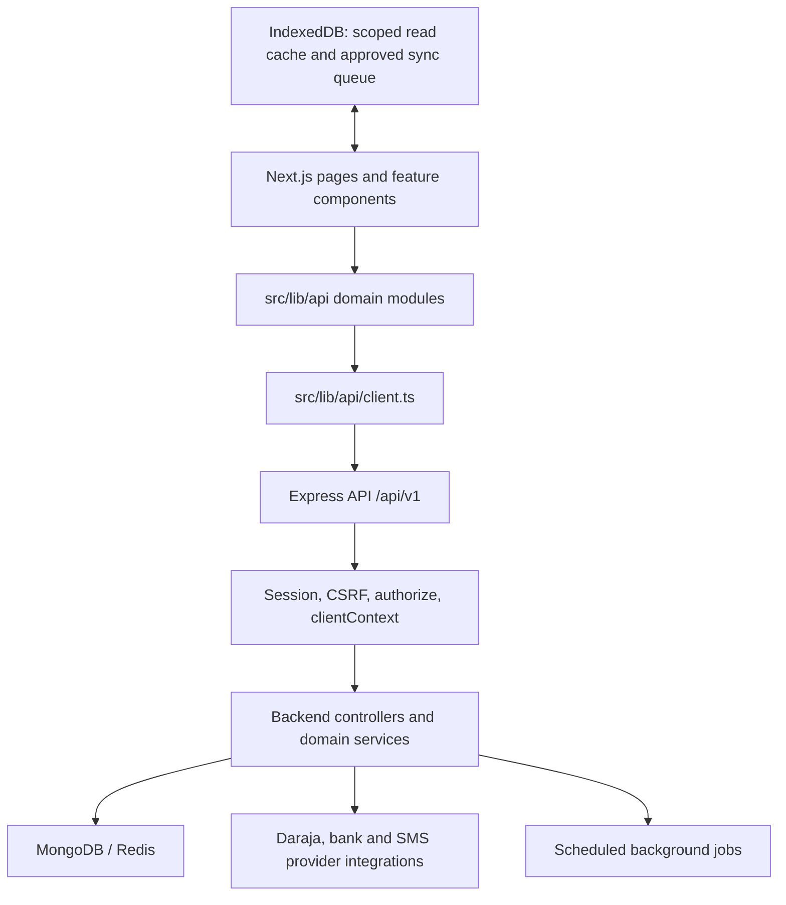

# Tycoon Estates Frontend — Architecture Outline

> Read this file first for a compact project map.  
> Audited: 2026-11-15  
> Frontend baseline: `jolla3/tycoon-frontend` `main` @ `dc34279bc8f8fcf98ffc9ce5029a7ea38c4f059d`  
> Backend contract baseline: `jolla3/tycoon-estates-backend` `main` @ `5aa05a2e81cb1ddc97f5507341a54a6b4a47ecb4`  
> Detailed product requirements: [`PRD.md`](PRD.md)  
> Endpoint-to-screen map: [`FRONTEND_ENDPOINT_SCREEN_MATRIX.md`](docs/FRONTEND_ENDPOINT_SCREEN_MATRIX.md)

## Agent context — compact outline

- **Product:** multi-tenant property/rent operations workspace for owners, admins, and staff, plus a separate SUPER_ADMIN platform console.
- **Not the product:** a full tenant portal. The tenant-facing M-PESA feature is a public one-time-link submission page only.
- **Frontend:** Next.js 14 App Router, React 18, strict TypeScript, MUI 6, TanStack Query 5, IndexedDB via `idb`, Recharts, Lucide React, Motion, and React Three Fiber only for the landing hero.
- **Backend:** Express API under `/api/v1`; it owns authentication, authorization, tenant/client scope, business rules, ledger state, bank/provider credentials, reconciliation, and canonical records.
- **HTTP boundary:** all authenticated feature requests go through `src/lib/api/client.ts`; feature modules live in `src/lib/api/*.ts`. Pages must not call `fetch` directly.
- **Session:** HttpOnly cookie session, `credentials: 'include'`, and centralized CSRF handling for mutations. Do not put session credentials in browser storage.
- **Server state:** TanStack Query. **Offline read cache:** IndexedDB, identity-scoped and visibly stale. **Offline writes:** only explicitly whitelisted safe operations (currently profile update). Financial writes stay online-only.
- **Financial distinctions:** `Payment` (posted ledger payment), `BankTransaction` (bank record), `MpesaSubmission` (SMS evidence), and `MpesaTransaction` (canonical provider receipt) are different models.
- **Never invent an endpoint:** missing M-PESA receipt listing, merchant-profile management, manual Pull query, password reset, notifications, or generic settings must remain explicit backend dependencies.
- **Current hard defects:** Banking skips the bank-connection lifecycle; house billing-config deactivation uses the wrong URL identifier; Tenants and Transactions omit the selected `estateId` from their list requests. Transactions then filters only the current paginated page. Houses already sends `estateId` to the backend, although its page comment incorrectly claims otherwise and its extra local filter is redundant. Backend middleware still enforces restricted STAFF estate scope when no explicit `estateId` is sent.
- **Planning rule:** keep `PRD.md`, this outline, and the endpoint/screen matrix synchronized before implementation.

## 1. Runtime and stack

| Layer | Current technology | Responsibility |
|---|---|---|
| App framework | Next.js 14.2.15 App Router | Public, client-workspace, and platform route groups |
| UI runtime | React 18.3, TypeScript 5.6 strict | Typed components and application behavior |
| Component/theme system | MUI 6, Emotion | Layout, forms, dialogs, tables, responsive styling |
| Server state | TanStack Query 5 | API queries, mutation lifecycle, invalidation |
| Local persistence | IndexedDB via `idb` | Approved read snapshots and the narrow sync queue |
| Charts | Recharts | Report visualizations |
| Icons | Lucide React | Single icon family |
| Motion | Motion | Limited UI animation |
| Landing visual | React Three Fiber / Three.js | Public landing hero only |

Current package scripts: `dev`, `build`, `start`, `lint`, and `typecheck`. There is no `test` script in the checked package manifest; a test harness is not established in this baseline.

## 2. System boundaries

The frontend is a client of the backend, not a second domain service. It must not implement ledger allocation, M-PESA matching, provider credential management, client scoping, or final payment status itself.

### Source layout

- `src/app/(public)`: landing, login, legal pages, and the future public `/pay` page.
- `src/app/(dashboard)`: authenticated client operational workspace.
- `src/app/(platform)`: SUPER_ADMIN-only platform routes.
- `src/features`: feature-specific state and components.
- `src/lib/api`: typed domain API wrappers and the shared HTTP client.
- `src/lib/permissions`: role-based UX helpers only.
- `src/lib/query`: TanStack Query provider/configuration.
- `src/lib/storage`: IndexedDB schema and cache helpers.
- `src/lib/sync`: connectivity and the explicit offline write allowlist.
- `src/components`: shared layout, feedback, data display, and forms.

## 3. Request and response contract

### Shared API client

`src/lib/api/client.ts` is the only approved HTTP boundary for feature API requests.

- Base URL comes from `NEXT_PUBLIC_API_BASE_URL`. Production must configure it at build time; development can fall back to local API.
- Authenticated requests use `credentials: 'include'`; frontend code does not read or store the HttpOnly session cookie.
- Mutating requests attach the CSRF token through the centralized client logic.
- Response handling expects the backend's standard envelope and returns `payload.data`.
- API failures become typed `ApiError` instances classified by network, auth, forbidden, validation, not-found, server, or unknown status.
- A page or feature module must not introduce its own fetch wrapper, auth header, or CSRF implementation.

### Domain modules

The current wrappers cover auth, profile, estates, houses, house types, tenants, billing, payments, deposits, banking accounts, bank transactions, SMS, reports, staff/users, subscription, and platform administration.

There is no M-PESA collection wrapper yet. Bank-connection routes are also not represented in the frontend API layer. The barrel at `src/lib/api/index.ts` does not currently re-export all existing domain modules; direct imports are in use. Treat barrel cleanup as code hygiene, not a substitute for implementing missing APIs.

## 4. Authentication, authorization, and scope

- Ordinary dashboard routes use the session context and authenticated route guard.
- Platform routes use the platform guard and require `SUPER_ADMIN`.
- The sidebar and `permissions` helper hide or disable actions for usability only.
- Backend `authorize()` middleware is the actual action-level security boundary.
- Backend client/estate scoping is server-derived by `clientContext`: a requested `estateId` is validated against the authenticated user’s allowed estates and becomes `req.estateFilter`; restricted STAFF without a requested estate receives their assigned `estateIds` as the filter. Never infer that a client-side estate dropdown provides security. Houses sends the selected estate; Tenants and Transactions currently omit it in their list wrappers. Transactions therefore narrows only the current fetched page in the browser.
- The public `/pay` page is intentionally outside the authenticated dashboard shell. Its public submission endpoint uses a separate backend guard.
- Credentialed cross-origin requests require exact-origin CORS with credentials enabled by the backend.

### Public M-PESA token handling

The backend builds a page URL in the form `{FRONTEND_URL}/pay#t={token}`. The token is in the URL fragment, which is not transmitted as part of the HTTP request for the page. The client page must extract it after hydration.

Rules:

1. Do not move the token into a query parameter.
2. Do not persist it in local storage, IndexedDB, a persistent query cache, analytics, telemetry, or logs.
3. Do not show the token again from a cached link record; the issue operation returns it once.
4. Submit only the backend contract `{ token, text }` to `POST /api/v1/public/mpesa/submissions`.
5. The UI response means evidence was accepted for processing, not that rent was posted.
6. Display neutral invalid/revoked/disabled-link feedback; do not disclose token validity details beyond the backend contract.

## 5. State ownership and persistence

| State | Owner | Persistence rule |
|---|---|---|
| Current user/session | Backend session + `SessionProvider` | No session secret in JS storage |
| API data | Backend; cached in TanStack Query | Invalidate/refetch after mutations |
| Approved read snapshots | IndexedDB | Identity-scoped; visible stale/cached marker |
| Offline write queue | IndexedDB sync queue | Explicit operation allowlist only |
| Financial writes | Backend | Online request and confirmed response only |
| UI state | React component state | Transient unless a product requirement explicitly says otherwise |

Current read-cache use is intentionally limited. A cached response must never be presented as live data. User identity changes clear query data, IndexedDB cache, and incompatible sync-queue entries to prevent cross-user exposure.

The current sync queue is deliberately narrow (profile update). Do not add payment creation, deposit operations, bank connection changes, bank sync, transaction assignment, or M-PESA submission resolution to it.

## 6. Frontend view models and financial semantics

Use backend DTOs as the source of truth. The frontend may add presentation-only derived labels, but must not replace backend financial state.

| Model | Meaning | Key rules |
|---|---|---|
| `Estate` | Client-owned property grouping | Client-scoped |
| `HouseType` | Reusable house classification and defaults | Not itself a tenancy or payment |
| `House` | Physical rental unit | Belongs to an estate; may have a current tenant |
| `Tenant` | Renter/customer record | Payer identity is not guaranteed to equal the person who sent money |
| `RentCharge` | Ledger charge for a period/type | Amounts are integer cents; backend owns allocations/status |
| `Payment` | Payment posted to the Tycoon ledger | Use for rent-ledger history |
| `BankConnection` | Provider authorization/credential connection | Separate lifecycle from an individual bank account |
| `BankAccount` | Account registered under a bank connection | Creation requires `connectionId` |
| `BankTransaction` | Imported bank transaction | Reconciliation record; not an M-PESA receipt |
| `MpesaSubmission` | Parsed tenant SMS evidence and review state | Evidence only; cannot independently create a payment |
| `MpesaTransaction` | Canonical provider receipt from Daraja ingestion | No frontend list endpoint in the audited backend baseline |

Money is transported as integer cents. Date/time values must follow the backend's documented timezone/ISO representation. Status values should be modeled from backend DTOs/enums, not made up in the UI.

## 7. Feature integration map

| Feature | Frontend route/screen | Backend API family |
|---|---|---|
| Authentication | `/login` and session context | `/auth/*` |
| Profile | `/profile` | `/profile/*` |
| Portfolio | `/estates`, `/houses`, `/house-types` | `/estates/*`, `/houses/*`, `/house-types/*` |
| Tenants | `/tenants` and tenant workspace | `/tenants/*`, `/deposits/*`, future `/mpesa-collection/*` |
| Billing | House workspace and future billing action | `/billing/*`, house billing-config routes |
| Payments | `/payments` | `/payments/*` |
| Bank integration | `/banking` | `/bank/connections/*`, `/bank/accounts/*` |
| Bank reconciliation | `/transactions`, `/transactions/unmatched` | `/transactions/*` |
| M-PESA submission | Future public `/pay` | `/public/mpesa/submissions` |
| M-PESA operator review | Tenant workspace + collections review queue | `/mpesa-collection/*` |
| Reporting | `/reports`, dashboard | `/reports/*` |
| Communications | `/sms` | `/sms/*` |
| Staff | `/staff` | `/users/*` |
| Subscription | `/settings` | `/subscription/*` |
| Platform | `/platform/*` | `/platform/*` |

The detailed endpoint map, frontend wrapper, current screen, role notes, and gap status live in `docs/FRONTEND_ENDPOINT_SCREEN_MATRIX.md`.

## 8. Known integration defects and blocked capabilities

### Frontend defects to fix

1. **Banking create flow:** current form calls `POST /bank/accounts` without first creating/selecting a bank connection and without the required `connectionId`. Add connection list/create/detail/reauthorize/disconnect wrappers and UI before account registration.
2. **Billing-config deactivation:** `housesApi.deactivateBillingConfig(houseId, chargeType)` builds a URL using the charge type. Backend route expects `:configId`. Change the input and URL to use the configuration ID.
3. **Estate filtering:** `clientContext` at the audited backend baseline validates a requested `estateId` and derives `req.estateFilter`; restricted STAFF users are automatically scoped to their assigned `estateIds` when no estate is requested. The Houses page already passes `estateId` through `housesApi.list` (its nearby source comment is stale and its extra local narrowing is redundant). The Tenants page calls `tenantsApi.list()` without the selected estate, then filters the returned array locally. The Transactions page omits `estateId` from `transactionsApi.list` and filters only the current paginated page. Add `estateId` to the Tenants and Transactions request types/calls, remove stale comments, and do not treat local filtering as authorization.
4. **API export surface:** `src/lib/api/index.ts` omits existing house-type, billing, deposit, and subscription modules. Normalize imports/exports when touching the API layer.

### Backend routes exist but frontend is missing

- M-PESA tenant link inspect/issue/revoke.
- M-PESA tenant SMS evidence submission.
- M-PESA submission list and supported resolve actions.
- Tenant M-PESA account/payment views, if these are needed beyond the existing tenant DTOs.

### Backend route is missing; do not invent it

- Canonical `MpesaTransaction` list/read API.
- Merchant profile management API.
- Manual Daraja Pull query API.
- Forgot/reset password.
- Backend notifications API.
- Generic settings API.

### Backend-only operations

Daraja C2B validation/confirmation, Pull result callbacks, and bank provider webhooks are provider-to-server routes. The browser must not call them. The Pull reconciliation scheduler is a backend job; platform health reports job state but does not expose a manual query operation.

## 9. Routing and role boundaries

- `(public)`: landing, login, privacy, terms, and future `/pay`.
- `(dashboard)`: authenticated client operations.
- `(platform)`: SUPER_ADMIN-only console.
- A Next.js route group in parentheses does not appear in the browser URL. A `page.tsx` beneath `src/app/(public)/pay` resolves to `/pay`.

The existing role helper grants management UX to `CLIENT_OWNER` and `CLIENT_ADMIN`, and platform access to `SUPER_ADMIN`. Staff visibility/actions are constrained in the UI and again by the backend. Never weaken backend enforcement to make a page work.

## 10. Implementation and verification rules

Before feature work:

1. Read `PRD.md`, this file, and the endpoint/screen matrix.
2. Confirm the current backend branch/commit and endpoint contract.
3. Identify whether the task is a frontend defect, an existing backend endpoint not yet surfaced, or a true backend API gap.
4. Update all three planning documents when the contract, workflow, role rules, or scope changes.
5. Only then implement.

For each feature, test: API client contract, response DTO parsing, pending/error/success UI, authorization boundaries, stale/offline behavior, keyboard use, responsive layout, and backend integration.

Do not claim tests passed unless the commands were executed against the current checked-out branch. Do not generate test-result files or persistent logs unless requested.
